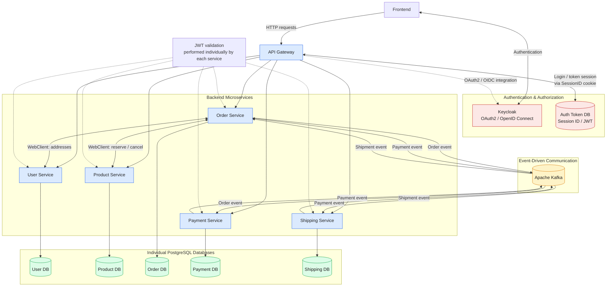
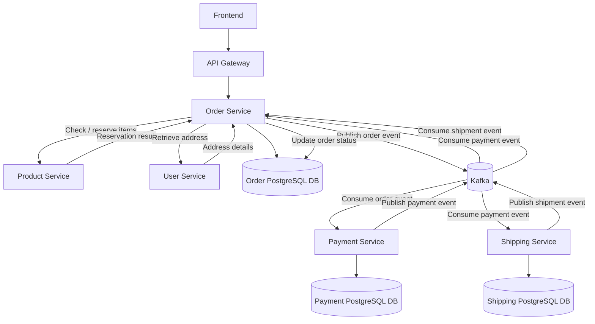

# E-Commerce Microservices

A backend e-commerce application built with Spring Boot and a microservices architecture. The system separates core business capabilities into independent services for users, products, orders, payments, and shipping, with a centralized API Gateway.


## Table of Contents

- [Overview](#overview)
- [Architecture](#architecture)
- [Technology Stack](#technology-stack)
- [Repository Structure](#repository-structure)
- [Configuration](#configuration)
- [Getting Started](#getting-started)
- [API Documentation](#api-documentation)
- [Testing](#testing)
- [License](#license)


## Overview

This project demonstrates a modular e-commerce backend built using Spring Boot microservices.

Each microservice is responsible for a specific business domain and can be developed, tested, and maintained independently.

### Key Features

- Modular microservices architecture
- Centralized API entry point
- BFF structure
- User authentication with OpenID and Authorization with OAuth2
- Role based account management: customer/shop/admin
- Event based order processing, payment handling, shipping handling and order notification
- Varying deployment possibilities: docker compose/kubernetes/aws

> Update this list to reflect the features currently implemented in your project.


## Architecture

The application consists of six microservices:

- **API Gateway** — Entry point for client requests and request routing.
- **User Service** — Manages user-related operations.
- **Product Service** — Handles product information and catalog operations. Also handles inventory and item reservation operations.
- **Order Service** — Manages order creation and order lifecycle. Enables order visibility both to customer and item provider.
- **Payment Service** — Handles payment-related operations.
- **Shipping Service** — Manages shipment and delivery-related operations.

### Overall microservices architecture


### Order and event workflow



## Technology Stack

- **Language:** Java
- **Framework:** Spring Boot (WebFlux for api-gateway and MVC for other services) 
- **Build Tool:** Maven
- **API:** REST
- **Database:** postgres
- **Containerization:** Docker
- **Testing:** JUnit 5, Mockito
- **API Documentation:** Swagger -- will be implemented soon
- **Authorization & Authentication:** Keycloak
- **Event Streaming:** Apache Kafka

## Repository Structure

```text
.
├── api-gateway/
├── order-service/
├── payment-service/
├── product-service/
├── shipping-service/
├── user-service/
├── README.md
├── compose.yaml
├── LICENSE
└── .gitignore
```


## Configuration

Configure each microservice using its application configuration files or environment variables. The port of each microservice has been hardcoded. It could be turned into environmental variables if required.

Do not commit passwords, API keys, tokens, or other secrets to the repository. All credentials in the repository is only for reference
There is still no secrets manager deployed in this project, which will be implemented soon.

The URLs are written in docker internal network style. 
For local debugging, examples should look like: http://localhost:4000
For aws deployment, examples should look like: http://demo-service.dns-namespace:4000

### Environment Variables — [Api-Gateway]

| Variable Name            | Description                                 | Data Type | Required | Example                                    |
|--------------------------|---------------------------------------------|-----------|----------|--------------------------------------------|
| `KEYCLOAK_CLIENT_ID`     | Access client for login with password grant | String    | Yes      | `portshop-admin`                           |
| `KEYCLOAK_CLIENT_SECRET` | Access client for login with password grant | String    | Yes      | `fMBKIo1lQV...`                            |
| `KEYCLOAK_REALM`         | Get/Refresh JWT access token                | String    | Yes      | `portshop-realm`                           |
| `KEYCLOAK_SERVER_URL`    | Get/Refresh JWT access token                | String    | Yes      | `http://portshop-keycloak:8080`            |
| `SPRING_R2DBC_USERNAME`  | Username for postgres database              | String    | Yes      | `admin_user`                               |
| `SPRING_R2DBC_PASSWORD`  | Password for postgres database              | String    | Yes      | `password`                                 |
| `SPRING_R2DBC_URL`       | Database for Getting JWT with Session ID    | String    | Yes      | `r2dbc:postgresql://auth-token-db:5432/db` |
| `SPRING_SQL_INIT_MODE`   | If or not trigger resource/schema.sql       | String    | Yes      | `always`                                   |
| `ORDER_SERVICE_URL`      | Routing for order service                   | String    | Yes      | `http://order-service:4003`                |
| `PAYMENT_SERVICE_URL`    | Routing for payment service                 | String    | Yes      | `http://payment-service:4004`              |
| `PRODUCT_SERVICE_URL`    | Routing for product service                 | String    | Yes      | `http://product-service:4001`              |
| `SHIPPING_SERVICE_URL`   | Routing for shipping service                | String    | Yes      | `http://shipping-service:4005`             |
| `USER_SERVICE_URL`       | Routing for user service                    | String    | Yes      | `http://user-service:4002`                 |
| `FRONTEND_CORS_URL`      | frontend url for CORS                       | String    | Yes      | `http://frontend:80`                       |

### Environment Variables — [Order Service]

| Variable Name                   | Description                                 | Data Type | Required | Example                                      |
|---------------------------------|---------------------------------------------|-----------|----------|----------------------------------------------|
| `KEYCLOAK_CLIENT_ID`            | Access client for login with password grant | String    | Yes      | `portshop-admin`                             |
| `KEYCLOAK_REALM`                | Get/Refresh JWT access token                | String    | Yes      | `portshop-realm`                             |
| `KEYCLOAK_SERVER_URL`           | Get/Refresh JWT access token                | String    | Yes      | `http://portshop-keycloak:8080`              |
| `SPRING_DATASOURCE_USERNAME`    | Username for postgres database              | String    | Yes      | `admin_user`                                 |
| `SPRING_DATASOURCE_PASSWORD`    | Password for postgres database              | String    | Yes      | `password`                                   |
| `SPRING_DATASOURCE_URL`         | Database for order/cart items               | String    | Yes      | `jdbc:postgresql://order-service-db:5432/db` |
| `SPRING_SQL_INIT_MODE`          | If or not trigger resource/schema.sql       | String    | Yes      | `always`                                     |
| `SPRING_JPA_HIBERNATE_DDL_AUTO` | create/update/none                          | String    | Yes      | `create`                                     |
| `USER_SERVICE_URL`              | Get user address with webclient             | String    | Yes      | `http://user-service:4002`                   |
| `PRODUCT_SERVICE_URL`           | Reserve and cancel order with webclient     | String    | Yes      | `http://product-service:4002`                |

### Environment Variables — [Payment Service]

| Variable Name                   | Description                                 | Data Type | Required | Example                                        |
|---------------------------------|---------------------------------------------|-----------|----------|------------------------------------------------|
| `KAFKA_SERVICE_URL`             | Kafka URL                                   | String    | Yes      | `portshop-kafka:9092`                          |
| `KEYCLOAK_CLIENT_ID`            | Access client for login with password grant | String    | Yes      | `portshop-admin`                               |
| `KEYCLOAK_REALM`                | Get/Refresh JWT access token                | String    | Yes      | `portshop-realm`                               |
| `KEYCLOAK_SERVER_URL`           | Get/Refresh JWT access token                | String    | Yes      | `http://portshop-keycloak:8080`                |
| `SPRING_DATASOURCE_USERNAME`    | Username for postgres database              | String    | Yes      | `admin_user`                                   |
| `SPRING_DATASOURCE_PASSWORD`    | Password for postgres database              | String    | Yes      | `password`                                     |
| `SPRING_DATASOURCE_URL`         | Database for payment                        | String    | Yes      | `jdbc:postgresql://payment-service-db:5432/db` |
| `SPRING_SQL_INIT_MODE`          | If or not trigger resource/schema.sql       | String    | Yes      | `never`                                        |
| `SPRING_JPA_HIBERNATE_DDL_AUTO` | create/update/none                          | String    | Yes      | `create`                                       |

### Environment Variables — [Product Service]

| Variable Name                   | Description                                 | Data Type | Required | Example                                        |
|---------------------------------|---------------------------------------------|-----------|----------|------------------------------------------------|
| `KEYCLOAK_CLIENT_ID`            | Access client for login with password grant | String    | Yes      | `portshop-admin`                               |
| `IMAGE_URI`                     | URI for product images                      | String    | Yes      | `/app/images`                                  |
| `KEYCLOAK_REALM`                | Get/Refresh JWT access token                | String    | Yes      | `portshop-realm`                               |
| `KEYCLOAK_SERVER_URL`           | Get/Refresh JWT access token                | String    | Yes      | `http://portshop-keycloak:8080`                |
| `SPRING_DATASOURCE_USERNAME`    | Username for postgres database              | String    | Yes      | `admin_user`                                   |
| `SPRING_DATASOURCE_PASSWORD`    | Password for postgres database              | String    | Yes      | `password`                                     |
| `SPRING_DATASOURCE_URL`         | Database for products and items             | String    | Yes      | `jdbc:postgresql://product-service-db:5432/db` |
| `SPRING_SQL_INIT_MODE`          | If or not trigger resource/schema.sql       | String    | Yes      | `never`                                        |
| `SPRING_JPA_HIBERNATE_DDL_AUTO` | create/update/none                          | String    | Yes      | `create`                                       |
| `USER_SERVICE_URL`              | Get shop role for data generation           | String    | Yes      | `http://user-service:4002`                     |

Image URI varies between deployments. 
For local debugging, it could be local path or resource service.
For kubernetes, it could be mounted file system or resource service.
For aws, s3 bucket is recommended. Besides, the image controller needs to be changed for aws version. Since now there is no aws profile configured, a manual change in image controller is required.

### Environment Variables — [Shipping Service]

| Variable Name                   | Description                                 | Data Type | Required | Example                                         |
|---------------------------------|---------------------------------------------|-----------|----------|-------------------------------------------------|
| `KAFKA_SERVICE_URL`             | Kafka URL                                   | String    | Yes      | `portshop-kafka:9092`                           |
| `KEYCLOAK_CLIENT_ID`            | Access client for login with password grant | String    | Yes      | `portshop-admin`                                |
| `KEYCLOAK_REALM`                | Get/Refresh JWT access token                | String    | Yes      | `portshop-realm`                                |
| `KEYCLOAK_SERVER_URL`           | Get/Refresh JWT access token                | String    | Yes      | `http://portshop-keycloak:8080`                 |
| `SPRING_DATASOURCE_USERNAME`    | Username for postgres database              | String    | Yes      | `admin_user`                                    |
| `SPRING_DATASOURCE_PASSWORD`    | Password for postgres database              | String    | Yes      | `password`                                      |
| `SPRING_DATASOURCE_URL`         | Database for shipment                       | String    | Yes      | `jdbc:postgresql://shipping-service-db:5432/db` |
| `SPRING_SQL_INIT_MODE`          | If or not trigger resource/schema.sql       | String    | Yes      | `never`                                         |
| `SPRING_JPA_HIBERNATE_DDL_AUTO` | create/update/none                          | String    | Yes      | `create`                                        |

### Environment Variables — [User Service]

| Variable Name                   | Description                                       | Data Type | Required | Example                                     |
|---------------------------------|---------------------------------------------------|-----------|----------|---------------------------------------------|
| `KEYCLOAK_CLIENT_ID`            | Access client for login with password grant       | String    | Yes      | `portshop-admin`                            |
| `KEYCLOAK_CLIENT_SECRET`        | Access client for login with password grant       | String    | Yes      | `fMBKIo1lQV...`                             |
| `KEYCLOAK_REALM`                | Get/Refresh JWT access token                      | String    | Yes      | `portshop-realm`                            |
| `KEYCLOAK_SERVER_URL`           | Get/Refresh JWT access token                      | String    | Yes      | `http://portshop-keycloak:8080`             |
| `SPRING_DATASOURCE_USERNAME`    | Username for postgres database                    | String    | Yes      | `admin_user`                                |
| `SPRING_DATASOURCE_PASSWORD`    | Password for postgres database                    | String    | Yes      | `password`                                  |
| `SPRING_DATASOURCE_URL`         | Database for user address, profile and credential | String    | Yes      | `jdbc:postgresql://user-service-db:5432/db` |
| `SPRING_SQL_INIT_MODE`          | If or not trigger resource/schema.sql             | String    | Yes      | `never`                                     |
| `SPRING_JPA_HIBERNATE_DDL_AUTO` | create/update/none                                | String    | Yes      | `create`                                    |

### Environment Variables — [Keycloak]

| Variable Name                 | Description                                                          | Data Type | Required | Example          |
|-------------------------------|----------------------------------------------------------------------|-----------|----------|------------------|
| `KC_BOOTSTRAP_ADMIN_USERNAME` | Keycloak bootstrap username                                          | String    | Yes      | `admin_user`     |
| `KC_BOOTSTRAP_ADMIN_PASSWORD` | Keycloak bootstrap password                                          | String    | Yes      | `password`       |
| `KC_DB`                       | Database type                                                        | String    | Yes      | `postgres`       |
| `KC_DB_USERNAME`              | Database username                                                    | String    | Yes      | `admin_user`     |
| `KC_DB_PASSWORD`              | Database password                                                    | String    | Yes      | `password`       |
| `KC_DB_URL`                   | Database for keycloak data                                           | String    | Yes      | `portshop-admin` |
| `KC_HOSTNAME_STRICT`          | Controls whether Keycloak requires an explicitly configured hostname | String    | Yes      | `false`          |
| `KC_HTTP_ENABLED`             | Controls whether http request is allowed, false by default           | String    | Yes      | `true`           |

### Environment Variables — [Kafka]

| Variable Name                                  | Description                                                                                              | Data Type | Required | Example                                              |
|------------------------------------------------|----------------------------------------------------------------------------------------------------------|-----------|----------|------------------------------------------------------|
| `KAFKA_ADVERTISED_LISTENERS`                   | The listener for all events                                                                              | String    | Yes      | `PLAINTEXT://portshop-kafka:9092`                    |
| `KAFKA_CONTROLLER_LISTENER_NAMES`              | Controller name                                                                                          | String    | Yes      | `CONTROLLER`                                         |
| `KAFKA_CONTROLLER_QUORUM_VOTERS`               | Kafka nodes participating in the KRaft controller quorum, managing metadata                              | String    | Yes      | `1@portshop-kafka:9093`                              |
| `KAFKA_INTER_BROKER_LISTENER_NAME`             | specifies which listener Kafka brokers use to communicate with each other                                | String    | Yes      | `PLAINTEXT`                                          |
| `KC_DB_PAKAFKA_LISTENER_SECURITY_PROTOCOL_MAP` | Maps Kafka listener names to security protocols                                                          | String    | Yes      | `CONTROLLER:PLAINTEXT,PLAINTEXT:PLAINTEXT`           |
| `KAFKA_LISTENERS`                              | Specifies worker nodes and controller                                                                    | String    | Yes      | `PLAINTEXT://0.0.0.0:9092,CONTROLLER://0.0.0.0:9093` |
| `KAFKA_NODE_ID`                                | specifies the unique numeric identifier for a Kafka server                                               | String    | Yes      | `1`                                                  |
| `KAFKA_OFFSETS_TOPIC_REPLICATION_FACTOR`       | specifies how many copies of Kafka's internal consumer-offsets topic should be maintained across brokers | String    | Yes      | `1`                                                  |
| `KAFKA_PROCESS_ROLES`                          | defines which role or roles a Kafka node performs in a KRaft cluster                                     | String    | Yes      | `broker,controller`                                  |

At present, the kafka topics are created by each microservices. Replica and partition numbers are hardcoded inside the config files. They will be forwarded to environment variables soon.

## Getting Started

### 1. Clone the repository

### 2. Configure the services

Review the configuration files for each microservice and provide the required environment-specific settings.

### 3. Start infrastructure dependencies

For local debugging: start any required databases, message brokers, or other infrastructure before launching the services.
Otherwise, for kubernetes or aws deployment, view the corresponding repository.

### 4. Build the application

### 5. Run the microservices

Start the services according to their dependencies and configuration. Start the API Gateway after its required downstream services or service-discovery infrastructure are available.

Refer to each service's configuration for its port and startup requirements.

## API Documentation

Swagger API will be implemented soon.

## Testing

At present, only minimal service and controller tests are implemented. Integration test or end-to-end test between frontend and backend is not in consideration.

Run the automated tests for each microservice.

For Maven-based services:

```bash
./mvnw test
```

view ./.github/workflows/tests.yml for CI tests. Edit the scopes of operation(push/pull request/...), on which the tests should run.

## License

This project is licensed under the terms specified in the [LICENSE](LICENSE) file.